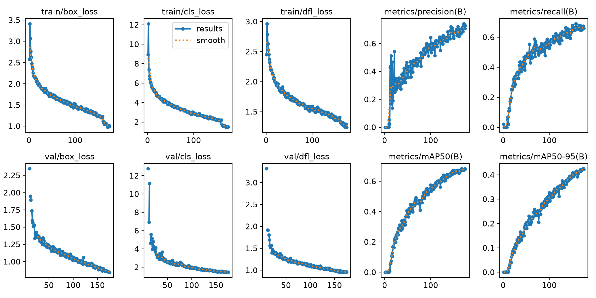
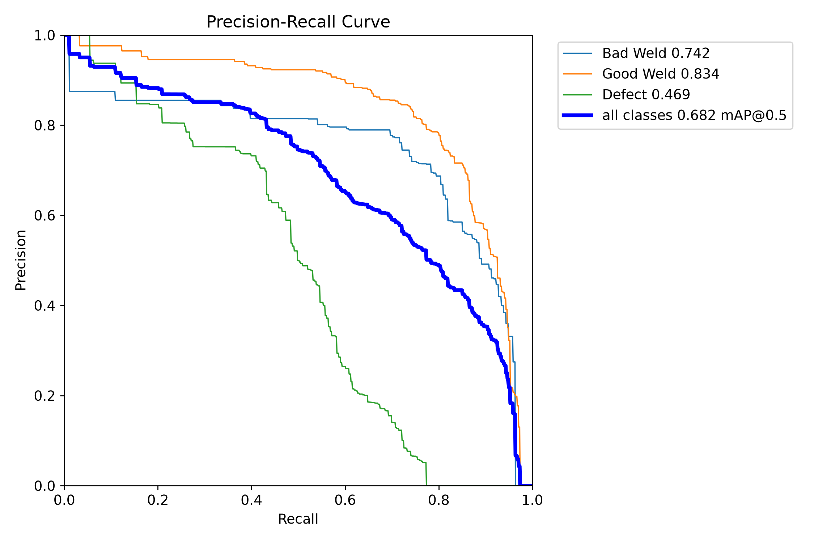
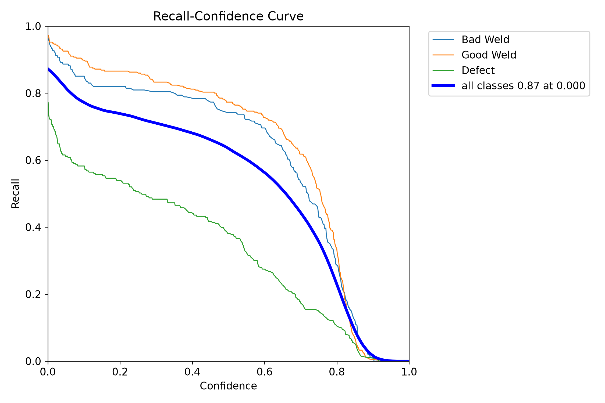
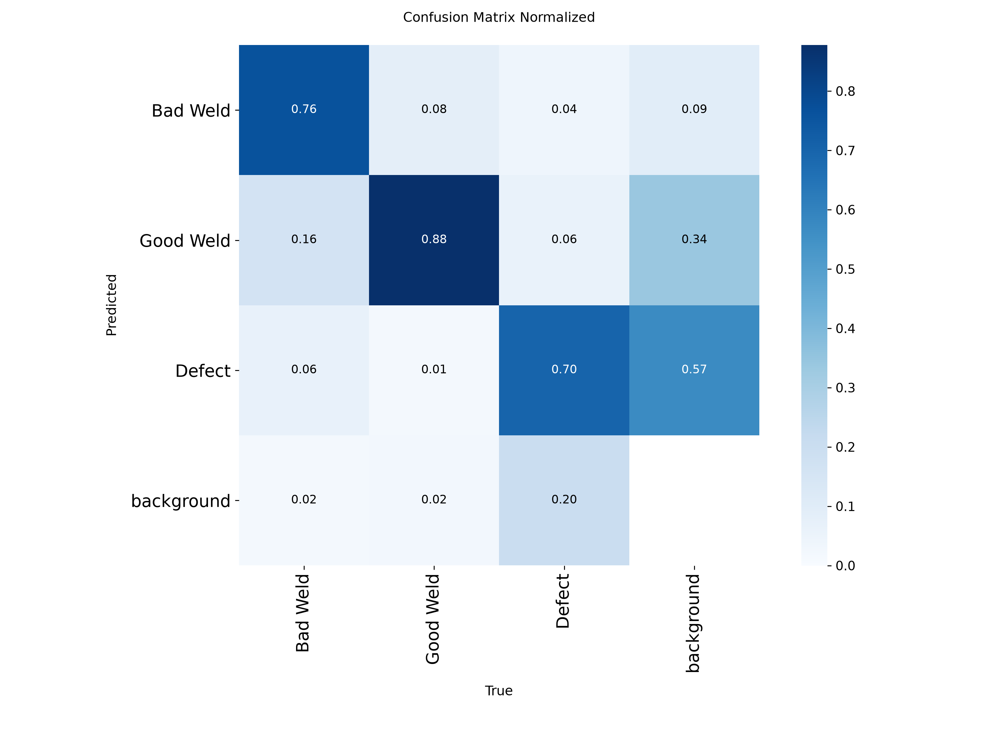
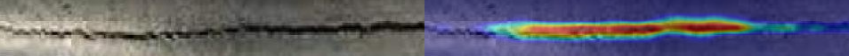
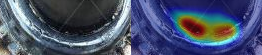
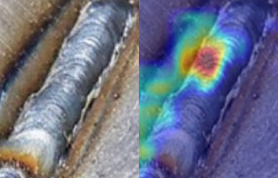

# Experiment 01 — Baseline Evaluation

**Status:** Validation baseline established; test-split, confidence-sweep, and gating-grid results are pending the A100 rerun of `scripts/analyze_baseline.py --device 0`.

## 1. Setup and data

### Model and effective training setup

- Architecture: YOLO11x, COCO-pretrained.
- Source images: 640 x 640, already resized during dataset preparation.
- Training budget: 175 epochs, AdamW effective optimizer, initial lr approximately 0.001429 despite the configured `lr0=0.01`, batch 128, AMP, seed 0, deterministic training, close-mosaic 15.
- Evaluation baseline: Ultralytics validation at conf `0.001`, IoU `0.7`, 640 px.
- Hardware for baseline training/evaluation: 4-GPU DDP on JupyterHub. Local Phase 1 smoke verification uses CPU; MPS is requested by the script and falls back to CPU when unavailable.

### Data diagnostics

| Split | Images | Bad Weld instances | Good Weld instances | Defect instances |
|---|---:|---:|---:|---:|
| Train | 1619 | 1089 | 1896 | 1598 |
| Val | 283 | 194 | 335 | 273 |
| Test | 126 | 95 | 117 | 89 |

All source images are already 640 px, so increasing `imgsz` primarily upsamples rather than adding pixels. Defect objects are small: median sqrt-area is 61 px in val (Bad Weld 161 px, Good Weld 108 px); 13.2% of val Defect instances are below 32 px. Defect is not rare in instance count.

Nested labels are semantically overlapping: 174/273 val Defect boxes (63.7%) overlap a Bad Weld box by more than 80% of the Defect area, versus 689/1598 (43.1%) in train. Video-frame source names appear across train and val, creating near-duplicate leakage risk. The test split was never evaluated during the baseline run and remains the hold-out.

## 2. Quantitative results

### Validation aggregate

| Split | P | R | mAP50 | mAP50-95 |
|---|---:|---:|---:|---:|
| Val | 0.7084 | 0.6739 | 0.6814 | 0.4248 |
| Test | `[Pending A100 run]` | `[Pending A100 run]` | `[Pending A100 run]` | `[Pending A100 run]` |

### Per-class validation

| Class | P | R | AP50 | AP50-95 |
|---|---:|---:|---:|---:|
| Bad Weld | `[Pending A100 run]` | `[Pending A100 run]` | 0.743 | `[Pending A100 run]` |
| Good Weld | `[Pending A100 run]` | `[Pending A100 run]` | 0.834 | `[Pending A100 run]` |
| Defect | `[Pending A100 run]` | `[Pending A100 run]` | 0.468 | `[Pending A100 run]` |

The per-class recall values below approximately 0.784 Bad Weld, 0.806 Good Weld, and 0.432 Defect correspond to the user's logged operating-point interpretation near conf 0.40. These will be regenerated directly from `metrics.box.class_result(i)` by the A100 script.

### Test per-class

| Class | P | R | AP50 | AP50-95 |
|---|---:|---:|---:|---:|
| Bad Weld | `[Pending A100 run]` | `[Pending A100 run]` | `[Pending A100 run]` | `[Pending A100 run]` |
| Good Weld | `[Pending A100 run]` | `[Pending A100 run]` | `[Pending A100 run]` | `[Pending A100 run]` |
| Defect | `[Pending A100 run]` | `[Pending A100 run]` | `[Pending A100 run]` | `[Pending A100 run]` |

### Confidence sweep

`[Pending A100 run of scripts/analyze_baseline.py; required conf sweep: 0.05, 0.10, 0.25, 0.40 on val and test.]`

Available R-curve evidence: Defect recall is approximately 0.43 at conf 0.40, approximately 0.57 at 0.10, with a ceiling near 0.77 when conf approaches zero.

### Training dynamics

The run reached its best fitness at epoch 174/175; mAP50-95 was 0.42506 at epoch 174 versus 0.42269 at epoch 175. Patience 100 did not trigger.

- Epochs 100-150 mean mAP50-95: 0.3511.
- Last 25 epochs mean mAP50-95: 0.4119.
- Final validation box/cls/dfl losses: 0.84636 / 1.46313 / 0.96218.
- The close-mosaic final 15 epochs produced a visible improvement, with mAP50-95 rising to approximately 0.425.

The first budget segment is unstable: validation losses are NaN in epochs 1-9, 11, and 14, and mAP is zero in epochs 2-8. Training cls loss peaks at 12.0974 in epoch 2. This is consistent with a warmup/AMP instability rather than overfitting.

### Confusion analysis

- 16% of true Bad Weld boxes are predicted as Good Weld, the critical escape path.
- 20% of true Defects are missed into background.
- Of background false positives, 57% are Defect and 34% are Good Weld.
- Defect-to-Bad Weld and Bad Weld-to-Defect confusion is small (4-6%), which is tolerable for a merged reject class.

### ONNX FP32 vs. INT8

| Metric | FP32 | INT8 |
|---|---:|---:|
| Export format | ONNX opset 17 | Static QDQ, per-channel |
| Input / feature map | 640, detections `(1,7,8400)`, feature_map `(1,768,40,40)` | Same exported model bundle |
| FP32 max output difference | 1.19e-3 vs. PyTorch | Not applicable |
| Size / latency / mAP50 / triage | `[Pending A100 or recorded benchmark rerun]` | `[Pending A100 or recorded benchmark rerun]` |

The baseline FP32 export verification passed; INT8 is static QDQ with the detect head kept in FP32 and 100 val-split calibration images. This calibration/re-evaluation overlap is biased. Local hardware is an i7-7Y75 CPU and is not suitable for the production benchmark; the table should be regenerated on the university host, where hardware must be recorded explicitly.

### Fail-Safe gating simulation

Fail-safe gate definition:

1. Auto-clear only when a Good Weld box exceeds `tau_good` and no Bad Weld or Defect box exceeds `tau_low`.
2. Empty predictions go to HITL review.
3. Everything except an evidence-backed clear is reviewed.

The `(tau_good, tau_low)` grid is `tau_good in {0.40, 0.50, 0.60, 0.70, 0.80}` and `tau_low in {0.05, 0.10, 0.20, 0.30, 0.40}`.

`[Pending A100 run: val and test escape rate, auto-clear rate, HITL review rate, and merged Bad Weld union Defect recall for every grid point.]`

### CAM previews

## 3. Engineering insights

1. The run is undertrained rather than overfit: close-mosaic and the last-epoch improvements suggest more schedule capacity.
2. Defect is the gating bottleneck; threshold-only tuning cannot exceed roughly 77% recall, so data/architecture/label semantics require attention.
3. A 16% Bad Weld-to-Good Weld confusion rate makes simple argmax or box-level triage unsafe.
4. Empty predictions, low secondary reject scores, and class-agnostic NMS are not aligned with the fail-safe image-level policy.
5. `copy_paste=0.3` is ineffective for box-only labels; class-power weighting is also a poor lever for Defect.
6. Val is optimistic because it selected `best.pt` and is source-leaked with video frames; test must be the final hold-out.

## 4. Prioritized hypotheses for Experiment 02

| Priority | Hypothesis | Change | Expected effect | Acceptance metric |
|---|---|---|---|---|
| P0 | Image-level dual thresholds can reduce unsafe clearance without retraining. | Per-image gating: Good Weld at `tau_good`, Bad Weld/Defect at `tau_low`; class-aware NMS; route empty/secondary evidence to HITL. Calibrate on val, freeze and report test. | Lower Bad Weld/Defect escape rate while producing an explicit review queue. | Test escape rate at/below target; HITL rate reported; reject recall improved. |
| P1 | Longer, explicit optimization improves stability and recall. | 300 epochs, patience 50, explicit AdamW lr0 ~1e-3 or SGD 0.01, cos_lr, longer warmup; investigate AMP/batch 64 vs. 128; remove copy-paste no-op. | Better convergence and fewer unstable warmup epochs. | Defect recall at `tau_low >= 0.65`; no val-loss NaNs; test mAP50-95 improves. |
| P2 | A stride-4 P2 head and small-object augmentation fit 640 px better. | Try YOLO11x-P2 and a cheap 960-px A/B; tune scale and reduce mixup. | Recover small Defect recall. | Defect AP50/recall improves without higher Bad Weld escape rate. |
| P3 | Nested Defect-in-Bad Weld labels distort independent-class learning. | Audit overlapping labels, relabel or merge to a `not_good` reject class where appropriate. | Cleaner reject evidence and fewer ambiguous gradients. | Merged reject recall improves; no regression in Good Weld precision. |
| P4 | Split and quantization hygiene is needed for credible generalization. | Group train/val/test by video source; preserve test as final hold-out; calibrate INT8 on train images only. | Removes leakage and calibration optimism. | Hold-out test escape/recall stable; FP32/INT8 gap within the predefined limit. |

Experiment 02 success criterion: Defect recall at `tau_low >= 0.65`, test escape rate at or below the agreed target, and HITL review rate reported for every selected threshold pair.
